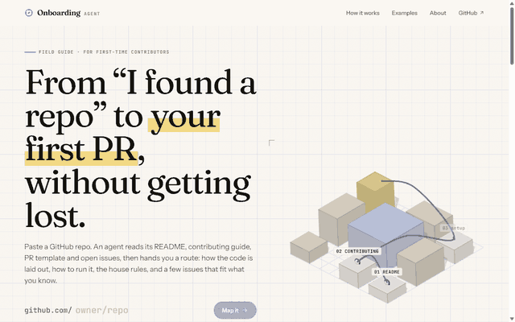
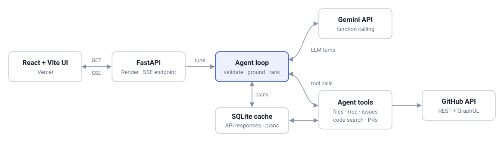
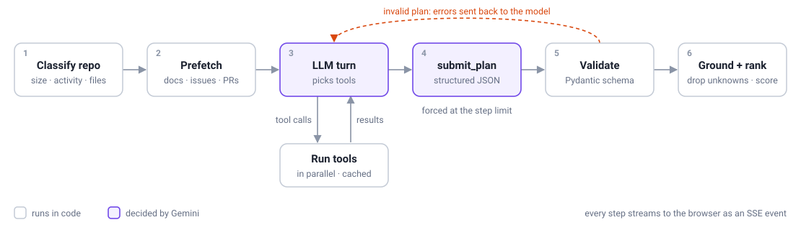

# Repo Onboarding Agent

Paste a GitHub repo, pick the languages you know, and get a personalised plan for your first contribution:
how the code is organised, how to set it up, the repo's own rules for commits and PRs, and a few open issues
that fit your skills. Shown as a checklist you can tick off.

> A student project, built to learn how tool-calling agents work end to end.
> **Live: [repo-onboarding-agent.vercel.app](https://repo-onboarding-agent.vercel.app)**
> The free backend sleeps when idle, so the first new repo can take ~30 s longer. The example plans open instantly.



<sub>Real agent output, sped up while the agent works. The first half is a live run on the deployed site (it
fell back to a backup model because the main one was busy, as the trace shows); the plan walkthrough at the
end was recorded locally from an earlier run of the same repo.</sub>

## Why

Starting on an open-source repo means hours of reading: README, CONTRIBUTING, folder layout, which issues are
actually free. First PRs often get closed for small things like the wrong branch, a missing changelog entry or
not following the PR template. This tool does that reading for you and points at where to start.

## What you get

1. **Architecture summary**: a plain-English overview plus what the key folders hold.
2. **Local setup steps**: exact commands taken from the docs or config files. Steps that aren't written down
   anywhere are marked *inferred*.
3. **House rules**: branch, commit, PR and code-style conventions, with the files they came from.
4. **3–5 ranked issues**: open and unassigned, each with a score, a suggested approach and the files likely involved.
5. **What first PRs here looked like**: based on recently merged PRs from first-time contributors.

## Architecture



## How the agent works



1. **Classify (code).** Repo size, activity and a list of notable files (docs, setup configs, linters, CI) are
   worked out from GitHub data. No LLM is needed for this.
2. **Prefetch (code).** The docs every plan needs, the candidate issues and the first-timer PRs are fetched in
   parallel and go into the first prompt. This cuts LLM requests from 5–8 per run to 2–3 (median 2 in the eval), which matters on
   the free tier.
3. **Investigate (LLM).** Gemini calls tools to fill the gaps:

   | Tool | What it does |
   |---|---|
   | `fetch_repo_file` | Read a file (capped at 12k chars) |
   | `list_repo_tree` | List a folder, skipping noise like `node_modules` |
   | `list_issues` | Open, unassigned issues with beginner labels, falling back to recent ones |
   | `search_code` | GitHub code search inside the repo |
   | `get_merged_prs_by_first_timers` | Recent merged PRs whose author had no earlier merged PR there |
   | `submit_plan` | Final answer as structured JSON (schema generated from Pydantic models) |

4. **Validate and repair.** `submit_plan` is checked with Pydantic. If it's invalid, the errors are sent back to the
   model to fix. At the step limit the model is forced to submit.
5. **Ground the output.** Issue numbers the agent never fetched, and file paths that aren't in the repo tree, are
   dropped. Issue titles and URLs come from GitHub, not from the model.
6. **Rank issues (hybrid).** Score = 40% signals computed from GitHub (label, freshness, how crowded the thread
   is, assignment) + 35% skill match and 25% difficulty fit, both judged by the model.

Each step is streamed to the browser as Server-Sent Events, so you can watch what the agent reads.

### Working within the free tier

Gemini's free tier allows a small number of requests per model per day, and the newest models are often
overloaded. So:

- Finished plans and raw GitHub responses are cached in SQLite.
- When a model returns 503 or runs out of quota, the run moves to the next model in a fallback chain, and the
  server remembers failing models for a few minutes.
- A per-IP rate limit protects the public demo. Cached plans don't count towards it.

## Evaluation

**51 of 56 expected facts found (91%) across 10 repos.** Full report:
[`backend/evals/results/report.md`](backend/evals/results/report.md).

How it works: for 10 well-known repos (Python, JS/TS, Rust, Go) I wrote 3–7 facts each by hand from the
repo's own CONTRIBUTING file and PR template: setup commands (`scripts/install`, `pnpm i`, `uv sync`) and
conventions (changelog entries, CLA, commit format). The facts were committed
([`evals/cases.json`](backend/evals/cases.json)) before the first run. The harness runs the agent fresh on
each repo and counts a fact as found if it appears in the plan's setup steps or conventions.

| | Result |
|---|---|
| Setup facts | 21/21 (100%) |
| Convention facts | 30/35 (86%) |
| Median time per fresh plan | 53 s (max 109 s) |
| Median per plan | 2 model turns, 9 tool calls, ~28k tokens |
| Estimated cost per plan | ~$0.06 at Gemini 3.6 Flash list price ($0 on the free tier) |

Notes:

- The misses were conventions the docs mention in passing (e.g. "commits are squashed on merge").
- 5 runs used `gemini-3.6-flash` and 5 fell back to `gemini-3.5-flash-lite` because 3.6 was overloaded.
- While checking each match by hand I found one over-broad pattern (`insta` matching "Install"), fixed it,
  and rescored: 52/56 became 51/56.
- It measures recall (are the expected facts there?), not precision. One plan mentioned a sign-off rule the
  repo doesn't have.

Run it yourself (uses your Gemini quota; results are saved per repo, so it can resume):

```bash
cd backend
uv run python -m evals.run_eval
```

## Running locally

You need Python 3.11+, [uv](https://docs.astral.sh/uv/), Node 18+, a free
[Gemini API key](https://aistudio.google.com/apikey) and a GitHub
[personal access token](https://github.com/settings/tokens) (read-only access to public repos is enough).

```bash
cd backend
cp .env.example .env        # then fill in GEMINI_API_KEY and GITHUB_TOKEN
uv sync
uv run uvicorn app.main:app --port 8000
```

```bash
cd frontend
npm install
npm run dev                 # http://localhost:5173
```

Or skip the UI and use the CLI:

```bash
cd backend
uv run python -m app.cli https://github.com/pallets/flask --lang python --level beginner
```

Run the tests (no API keys needed; GitHub and the LLM are faked):

```bash
cd backend
uv run pytest
```

## Project layout

```
backend/app/
  agent.py     agent loop, prompt, grounding and enrichment
  tools.py     repo classification and the agent's tools
  llm.py       Gemini wrapper with retries and model fallback
  github.py    cached GitHub REST/GraphQL client
  scoring.py   issue scoring
  schemas.py   Pydantic models (also generate the tool schema)
  cache.py     SQLite key-value cache with TTLs
  main.py      FastAPI app and SSE endpoint
  cli.py       command-line runner
backend/evals/ eval cases, runner, scorer and saved results
frontend/src/  React UI (landing, plan page, live agent trace, checklist)
docs/          diagrams and the deploy guide
```

Deploying: see [`docs/deploy.md`](docs/deploy.md) (Render for the API, Vercel for the frontend).

## Limitations

- Plans are only as good as the repo's docs. If CONTRIBUTING lives on an external site, the agent says so but
  doesn't follow the link.
- The LLM can still be wrong. Double-check commands before running them.
- On Render's free plan the cache resets whenever the server restarts, and the first request after a quiet
  period takes about 30 seconds while the server wakes up.

## Roadmap

- **Pre-PR diff checker**: paste your diff before opening a PR and check it against the repo's conventions
  (tests touched, changelog updated, commit format, PR template filled in).
- Measure precision: flag claims in a plan that the repo's docs don't support.
- Follow contributing guides hosted outside the repo.
- Detect issues that already have a linked open PR.
- Shareable plan links.
